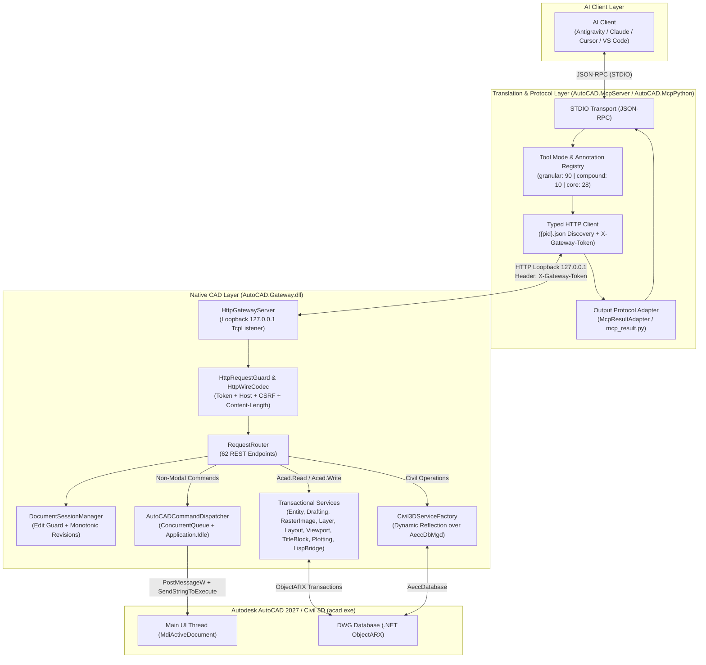
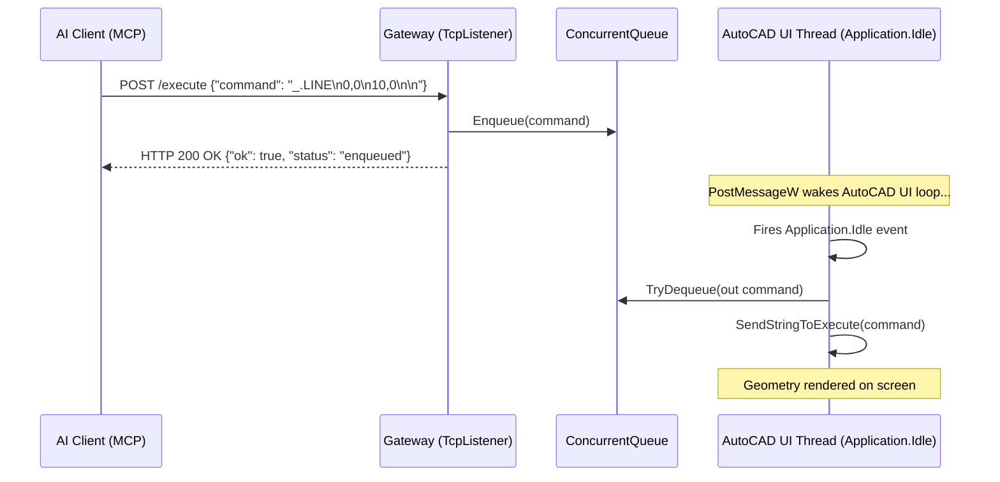

# System Architecture — AutoCAD MCP (`autocad-mcp`)

This document details the architectural principles, network topology, concurrency model, output protocol, and UI thread synchronization mechanisms powering the integration with Autodesk AutoCAD 2027 and Civil 3D 2027.

---

## 1. Topology Overview

The **AutoCAD MCP** ecosystem operates using a decoupled, two-tier architecture connected via industry-standard protocols:

---

## 2. Decoupled Components & Mandatory Complementarity

| Component | Execution Environment | Critical Role |
|---|---|---|
| **AutoCAD.Gateway** | In-process within `acad.exe` (loaded via `NETLOAD` or Autoloader `.bundle`). | **Sensor & Actuator:** Direct memory access to the active AutoCAD process. Transactionally queries/mutates the drawing database (`Acad.Read` / `Acad.Write`), enforces Edit Guard, and dispatches UI-thread instructions safely. |
| **AutoCAD.McpServer / McpPython** | Independent console process (.NET 10 / Python FastMCP). | **AI Translator:** Implements Model Context Protocol (MCP v2.2). Exposes 90 tools (`granular`), 10 domain routers (`compound`), or 28 tools (`core`), validates parameters, and formats `compact` / `json` `CallToolResult` envelopes. |

> [!IMPORTANT]
> **Why neither component can be used in isolation:**
> - The **MCP Server** alone cannot access COM objects or the ObjectARX engine without the in-process Gateway.
> - The **Gateway** alone would force AI agents to improvise terminal scripts via PowerShell or cURL, burning context tokens on raw JSON dumps and losing typed schema validation and MCP `ToolAnnotations`.

---

## 3. Transport, Discovery & Security (`v2.5.0+`)

- **Loopback `TcpListener` + `{pid}.json` Discovery:** `HttpGatewayServer` binds strictly to `127.0.0.1` on an ephemeral or configured port and writes a per-session `{pid}.json` discovery file. Both `AutoCADGatewayClient` (.NET) and `client.py` (Python) auto-discover active sessions without requiring hardcoded ports.
- **`HttpRequestGuard` & `HttpWireCodec`:** Enforces constant-time `X-Gateway-Token` comparison, strict `Host` validation, `Origin`/`Referer`/`Sec-Fetch-*` CSRF rejection, and fixed `Content-Length` framing.
- **`DocumentSessionManager` (Edit Guard & Optimistic Concurrency):** Tracks per-document session IDs, monotonic database mutation revisions, and `IsManaged` flags so pre-existing user drawings are protected until authorized via `allow_edit_document` or `AI_EDIT_GUARD`.
- **Standardized Gateway Envelope:** `RequestRouter` wraps responses with `ok`, `status`, and `duration_ms`, plus structured `error.hint` diagnostics.

---

## 4. Concurrency Model & Thread Safety

Automating AutoCAD from external network services presents a major challenge: **AutoCAD is a Single-Threaded Apartment (STA) application** across its graphic viewport and document object model.

### The Risk
If a background worker thread directly invokes `Document.SendStringToExecute()` or starts a transaction on `Database`, AutoCAD throws a fatal exception (`InvalidOperationException: Drawing is busy` or an unhandled Access Violation).

### The Architecture Solution
1. **Asynchronous Background Ingestion:** Incoming HTTP requests are handled by `HttpGatewayServer` (`TcpListener`).
2. **Direct Main-Thread Marshaling (`Acad.Read` / `Acad.Write` / `Acad.RunOnDocumentAsync`):** Transactional ObjectARX operations marshal onto AutoCAD's main thread using `StartOpenCloseTransaction` for reads and single-transaction `Acad.Write` locks for atomic mutations, plus synchronous `LispBridge` execution on the command loop.
3. **Command Queue & `Application.Idle` (`AutoCADCommandDispatcher`):** Queued command strings are placed onto a `ConcurrentQueue<string>` and woken via `[DllImport("user32.dll")] PostMessageW` so the `Application.Idle` handler drains them on the UI thread and detaches immediately once empty.

---

## 5. Modular Gateway Services & MCP Output Protocol (`v2.7.0`)

### Decomposed Gateway Services (`AutoCAD.Gateway/Services/`)
- **Context & Entity CRUD:** `AutoCADContextReader`, `EntityQueryService`, `EntityService`, `EntityBuilder`, `EntityModifier`, `EntityTransformer`.
- **Drafting, Blocks & Layers:** `DraftingService`, `RasterImageService`, `BlockService`, `LayerService`.
- **Plotting & Layouts:** `LayoutService`, `ViewportService`, `TitleBlockBuilder`, `PlottingService` (silent synchronous `PlotEngine` with `BACKGROUNDPLOT=0`).
- **Documents & AutoLISP:** `DocumentControlService`, `LispBridge`.
- **Shared Contracts (`AutoCAD.Gateway.Contracts`):** `GatewayProtocol`, `GatewayToolCatalog`, `LineWeightPolicy`, `DwgVersionPolicy`, `PlottingPolicy`, `OutputFormat`, `ToolAnnotationPolicy`, `SecurityPolicy`.

### MCP Output Protocol (`McpResultAdapter` / `mcp_result.py`)
- **`AUTOCAD_MCP_OUTPUT_FORMAT=compact` (default):** Emits token-reduced tabular/key-value summaries in `content[0].text` paired with full JSON in `structuredContent`.
- **`AUTOCAD_MCP_OUTPUT_FORMAT=json`:** Emits legacy raw JSON strings in `content[0].text` alongside `structuredContent`.
- **Native Protocol Semantics:** Validation, Gateway, and partial-batch errors set `CallToolResult.isError = true` (omitting `structuredContent`); `capture_screenshot(inline=true)` returns native `ImageContent` (`image/png`) without raw base64 in text or `structuredContent`; all tools advertise deterministic `ToolAnnotations`.

---

## 6. Command Robustness: Auto-Cancellation & Non-Modal Execution

### Escape Sequence Injection (`\x03\x03`)
Every command dispatched by `AutoCADCommandDispatcher` automatically prepends and appends `\x03\x03` (equivalent to double `Ctrl+C` / `ESC`). This resets AutoCAD to a clean command prompt if a prior routine left an uncommitted prompt open.

### Text-Mode Interactive Commands (`_.-`)
To prevent Windows modal dialogs from halting remote execution, command-line fallbacks strictly use text-mode variants:
- `_.-LAYER` instead of `LAYER`.
- `_.-INSERT` instead of `INSERT`.
- `_.-PLOT` instead of `PLOT`.

---

## 7. Autodesk Civil 3D Dynamic Integration

To ensure `AutoCAD.Gateway` does not crash on machines running vanilla AutoCAD:
- `Civil3DServiceFactory` dynamically inspects process memory at runtime to detect `AeccDbMgd.dll`.
- If present, it initializes `Civil3DService` enabling TIN surface inspection/creation, longitudinal profiles, cross-sections, and alignment operations.
- If absent, it initializes `NullCivil3DService`, returning structured metadata indicating Civil 3D is inactive without throwing exceptions.
