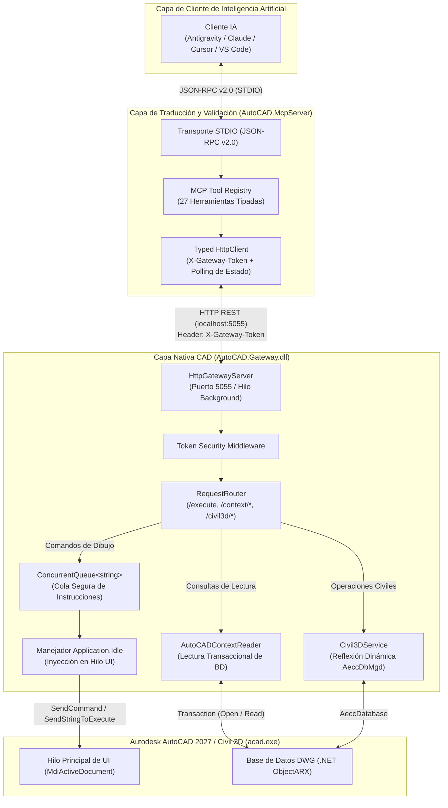
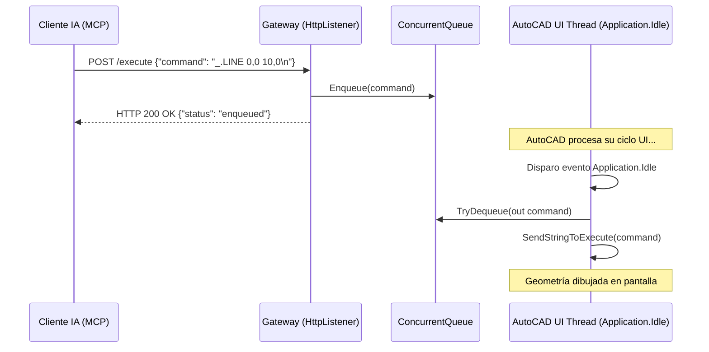

# Arquitectura del Sistema — AutoCAD MCP (`autocad-mcp`)

Este documento detalla los principios de diseño, la topología de red, el modelo de concurrencia y la sincronización con el hilo de interfaz de usuario de Autodesk AutoCAD 2027 y Civil 3D.

---

## 1. Visión General de la Topología

El ecosistema **AutoCAD MCP** opera mediante una arquitectura desacoplada de dos capas conectadas por protocolos estándar de la industria:

---

## 2. Los Dos Componentes y su Complementariedad Obligatoria

| Componente | Entorno de Ejecución | Rol Crítico |
|---|---|---|
| **AutoCAD.Gateway** | Dentro de `acad.exe` (cargado mediante `NETLOAD`). | **Sensor y Actuador:** Tiene acceso directo a la memoria del proceso de AutoCAD. Lee la base de datos de dibujo de forma transaccional e inyecta órdenes en el hilo principal de manera segura. |
| **AutoCAD.McpServer** | Proceso de consola independiente (.NET 10). | **Traductor de la IA:** Implementa el Model Context Protocol (v2.2). Expone las herramientas fuertemente tipadas a los LLMs, valida los esquemas JSON y asla al cliente de llamadas HTTP directas y riesgos de formato. |

> [!IMPORTANT]
> **Por qué no usar uno sin el otro:**
> - El **MCP Server** por sí solo no puede acceder a los objetos COM ni al motor ObjectARX de AutoCAD sin el Gateway.
> - El **Gateway** por sí solo obligaría a los agentes de IA a improvisar llamadas de red con PowerShell o cURL, consumiendo miles de tokens de contexto con respuestas JSON en crudo y aumentando la probabilidad de fallos de sintaxis.

---

## 3. Modelo de Concurrencia y Seguridad de Hilos (Thread Safety)

Uno de los mayores desafíos al automatizar AutoCAD desde servicios de red externos es que **AutoCAD es una aplicación de hilo único (Single-Threaded Apartment - STA)** en su capa gráfica y documental.

### El Riesgo:
Si un hilo secundario (como el hilo de trabajo de `HttpListener`) intenta invocar `Document.SendStringToExecute()` o abrir una transacción en `Database`, AutoCAD genera de inmediato una excepción crítica (`InvalidOperationException: Drawing is busy` o Access Violation).

### La Solución Implementada:
1. **Recepción en Segundo Plano:** Las peticiones HTTP entrantes son atendidas asíncronamente por `HttpGatewayServer` en el puerto `5055`.
2. **Encolado Concurrente:** El comando se coloca en una estructura `ConcurrentQueue<string>`.
3. **Sincronización con `Application.Idle`:**
   - El Gateway se suscribe al evento `Application.Idle` de AutoCAD.
   - Tan pronto como la interfaz de usuario de AutoCAD queda inactiva y segura para recibir comandos, el manejador se activa, extrae los comandos de la cola y los ejecuta en el contexto del hilo UI principal.
   - Inmediatamente después de vaciar la cola, el evento se desacopla para no generar sobrecarga de CPU.

---

## 4. Robustez de Comandos: Auto-Cancelación y No Modalidad

### Inyección de Secuencias de Escape (`\x03\x03`)
Cualquier comando inyectado por el Gateway antepone automáticamente la secuencia ASCII `\x03\x03` (equivalente a presionar dos veces `Ctrl+C` o `ESC`). Esto garantiza que si el usuario o una rutina previa dejó un comando abierto o esperando un clic, AutoCAD cancele ese estado y reciba la nueva instrucción de forma limpia.

### Comandos de Modo Texto (`_.-`)
Para evitar que se abran ventanas de diálogo modales de Windows (que detendrían la ejecución remota hasta que un usuario interactúe físicamente con el ratón), el Gateway y las herramientas MCP utilizan sistemáticamente comandos en su variante de línea de comandos:
- `_.-LAYER` en lugar de `LAYER`.
- `_.-INSERT` en lugar de `INSERT`.
- `_.-PLOT` en lugar de `PLOT`.

---

## 5. Integración con Autodesk Civil 3D

Para no hacer que `AutoCAD.Gateway` dependa estrictamente de las DLLs de Civil 3D en máquinas que solo tengan AutoCAD básico:
- Se utiliza el patrón Factory con **Carga Condicional por Reflexión**:
  - `Civil3DServiceFactory` verifica en tiempo de ejecución si el módulo administrado `AeccDbMgd.dll` está presente en el proceso activo.
  - Si está disponible, inicializa `Civil3DService` y permite la inspección y modelado de superficies TIN y alineamientos.
  - Si no está disponible, inicializa `NullCivil3DService`, devolviendo respuestas estructuradas indicando que Civil 3D no está activo, sin provocar caídas de la aplicación.
