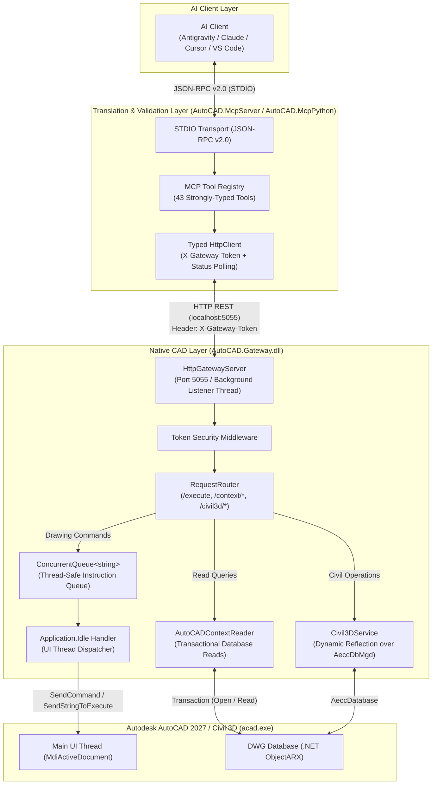
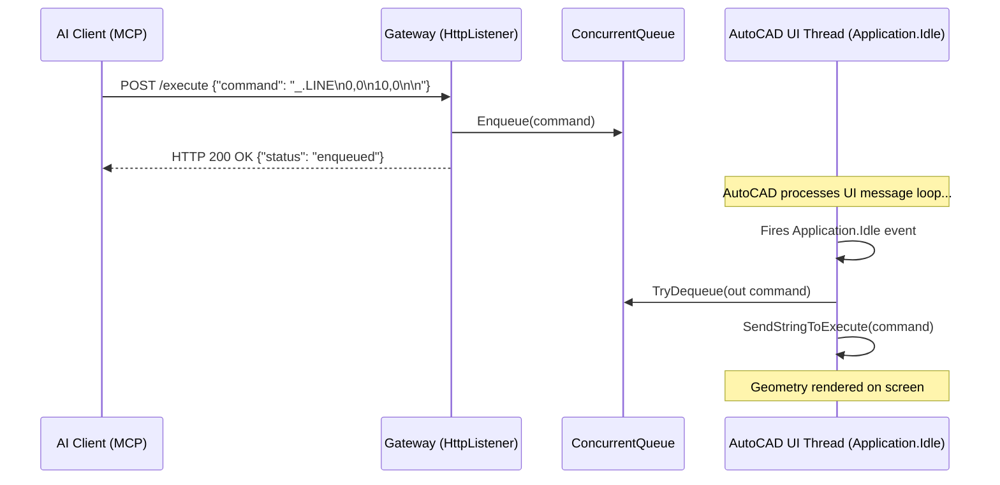

# System Architecture — AutoCAD MCP (`autocad-mcp`)

This document details the architectural principles, network topology, concurrency model, and UI thread synchronization mechanisms powering the integration with Autodesk AutoCAD 2027 and Civil 3D.

---

## 1. Topology Overview

The **AutoCAD MCP** ecosystem operates using a decoupled, two-tier architecture connected via industry-standard protocols:

---

## 2. Decoupled Components & Mandatory Complementarity

| Component | Execution Environment | Critical Role |
|---|---|---|
| **AutoCAD.Gateway** | In-process within `acad.exe` (loaded via `NETLOAD`). | **Sensor & Actuator:** Direct memory access to the active AutoCAD process. Transactionally queries the drawing database and safely dispatches instructions to the main UI thread. |
| **AutoCAD.McpServer / McpPython** | Independent console process (.NET 10 / Python). | **AI Translator:** Implements Model Context Protocol (v2.2). Exposes strongly-typed tools to LLMs, validates JSON schemas, and isolates the AI client from raw HTTP calls and syntax risks. |

> [!IMPORTANT]
> **Why neither component can be used in isolation:**
> - The **MCP Server** alone cannot access COM objects or the ObjectARX engine without the in-process Gateway.
> - The **Gateway** alone would force AI agents to improvise terminal scripts via PowerShell or cURL, burning thousands of context tokens on raw JSON dumps and introducing syntax risks.

---

## 3. Concurrency Model & Thread Safety

Automating AutoCAD from external network services presents a major challenge: **AutoCAD is a Single-Threaded Apartment (STA) application** across its graphic viewport and document object model.

### The Risk:
If a background worker thread (such as the `HttpListener` thread pool) directly invokes `Document.SendStringToExecute()` or starts a transaction on `Database`, AutoCAD immediately throws a fatal exception (`InvalidOperationException: Drawing is busy` or an unhandled Access Violation).

### The Architecture Solution:
1. **Asynchronous Background Ingestion:** Incoming HTTP requests are handled asynchronously by `HttpGatewayServer` on port `5055`.
2. **Concurrent Queue:** Command strings are placed onto a thread-safe `ConcurrentQueue<string>`.
3. **Synchronization with `Application.Idle`:**
   - The Gateway attaches to AutoCAD's `Application.Idle` event.
   - Once the AutoCAD UI thread completes its rendering cycle and enters an idle state, the handler wakes up, dequeues pending commands, and executes them within the primary UI thread context.
   - Immediately after draining the queue, the handler detaches from `Application.Idle` to eliminate unnecessary CPU overhead.

---

## 4. Command Robustness: Auto-Cancellation & Non-Modal Execution

### Escape Sequence Injection (`\x03\x03`)
Every command dispatched by the Gateway automatically prepends the ASCII sequence `\x03\x03` (equivalent to double `Ctrl+C` or `ESC`). This ensures that if the user or a prior routine left an uncommitted command awaiting input, AutoCAD resets to a clean prompt before executing the new instruction.

### Text-Mode Interactive Commands (`_.-`)
To prevent Windows modal dialogs from halting remote execution (which would block the connection until a human physically clicks the UI), the Gateway and MCP tools strictly use text-mode command variants:
- `_.-LAYER` instead of `LAYER`.
- `_.-INSERT` instead of `INSERT`.
- `_.-PLOT` instead of `PLOT`.

---

## 5. Autodesk Civil 3D Dynamic Integration

To ensure `AutoCAD.Gateway` does not crash on machines running standard vanilla AutoCAD:
- The system employs a Factory pattern with **Conditional Reflection Loading**:
  - `Civil3DServiceFactory` dynamically inspects the process memory at runtime to detect `AeccDbMgd.dll`.
  - If present, it initializes `Civil3DService` enabling TIN surface inspection and alignment operations.
  - If absent, it initializes `NullCivil3DService`, returning structured metadata indicating Civil 3D is inactive, without throwing exceptions or failing execution.
