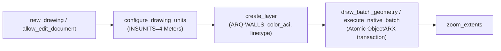
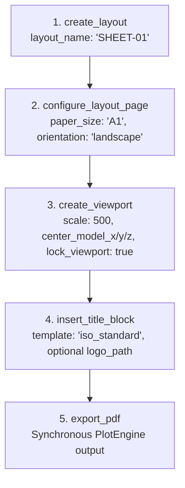
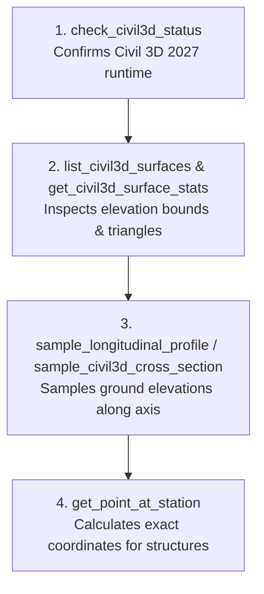
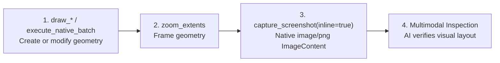

# Quick Reference & Decision Tree (MCP Tools Cheat Sheet)

This document serves as an actionable cheat sheet and decision guide for developers, engineers, and AI models interacting with **`autocad-mcp`** (`v2.7.0`, 90 tools: 76 canonical + 14 legacy aliases across 10 domains).

- **Tool Modes (`AUTOCAD_MCP_TOOL_MODE`):** `granular` (default, 90 tools), `compound` (10 domain routers `autocad_context`–`autocad_execution` with `action="help"`), or `core` (28 high-leverage tools).
- **Output Format (`AUTOCAD_MCP_OUTPUT_FORMAT`):** `compact` (default, token-reduced summary + `structuredContent`) or `json` (raw JSON text).

---

## Quick Decision Matrix: "Goal" -> "Canonical Tool"

| Design Goal / Intent in CAD | Canonical Tool (Domain) | Key Arguments | Requires CAD? |
|---|---|---|:---:|
| **Check Gateway connectivity & active session** | `ping_gateway` (`execution`) | *(none)* | Yes |
| **List Gateway HTTP routes & undo/Edit Guard rules** | `get_gateway_tools` / `get_gateway_guide` (`context`) | *(none)* | Yes |
| **Get drawing name, DWG path, and units** | `get_drawing_info` (`context`) | *(none)* | Yes |
| **Query bounding box extents (`ExtMin`/`ExtMax`)** | `get_drawing_extents` (`context`) | *(none)* | Yes |
| **Inspect entity counts, layers, texts, blocks, selection** | `get_entities`, `get_layers`, `get_texts`, `list_blocks`, `get_selection_count` (`context`) | *(none)* | Yes |
| **Capture drawing screenshot (multimodal `ImageContent`)** | `capture_screenshot` (`context`) | `inline: true` | Yes |
| **Filter entities by type, layer, space, 2D bbox, or text** | `query_entities` (`entities`) | `types, layers, min_x, max_x, limit, cursor` | Yes |
| **Inspect or modify one entity by hexadecimal handle** | `get_entity` / `modify_entity` (`entities`) | `handle, ...` | Yes |
| **Move, rotate, scale, copy, or mirror entities atomically** | `transform_entities` (`entities`) | `handles, operation, dx, dy, angle, factor` | Yes |
| **Delete entities or run up to 500 native ops atomically** | `delete_entities` / `execute_native_batch` (`entities`) | `handles` / `operations, rollback_on_error` | Yes |
| **Measure distance, azimuth, or slope between points** | `measure_distance` (`measurement`) | `x1, y1, x2, y2, z1, z2` | No (Local) |
| **Calculate polygon area, perimeter, and centroid** | `calculate_polygon_area` (`measurement`) | `points: "x1,y1;x2,y2;..."` | No (Local) |
| **Purge unreferenced definitions and audit DWG** | `purge_and_audit_drawing` (`measurement`) | `target: "all", audit: true` | Yes |
| **Configure metric standard (`INSUNITS=4`)** | `configure_drawing_units` (`execution`) | *(none)* | Yes |
| **Draw multiple entities / complete floor plan in 1 call** | `draw_batch_geometry` (`drawing`) | `elements: [...]` | Yes |
| **Draw line, polyline, rectangle, circle, arc, text, block** | `draw_line`, `draw_polyline`, `draw_rectangle`, `draw_circle`, `draw_arc`, `insert_text`, `insert_block` (`drawing`) | coordinates, `layer` | Yes |
| **Attach and place a raster image (`PNG`/`JPG`/`BMP`/`TIF`)** | `insert_raster_image` (`drawing`) | `file_path, x, y, width, height, image_frame` | Yes |
| **Create native dimensions, mleaders, hatches, or tables** | `create_dimension`, `create_mleader`, `create_hatch`, `create_table` (`drafting`) | geometry / `handles` / `cells_json` | Yes |
| **Define blocks, read/update attributes, list Xrefs, explode** | `define_block`, `get_block_definition`, `get_block_attributes`, `set_block_attributes`, `list_xrefs`, `explode_entities` (`drafting`) | `name` / `handle` / `handles` | Yes |
| **Create, activate, modify, or delete a layer** | `create_layer`, `set_current_layer`, `set_layer_state`, `delete_layer` (`layers`) | `name, color_aci, linetype, lineweight, action` | Yes |
| **Manage MDI documents & Edit Guard** | `list_documents`, `new_drawing`, `open_drawing`, `activate_document`, `close_document`, `allow_edit_document` (`documents`) | `document` / `file_path` / `allow` | Yes |
| **Cancel active prompt or read/set system variables** | `cancel_command`, `get_system_variable`, `set_system_variable` (`documents`) | `name, value` | Yes |
| **Create layout, configure A0–A4 page, viewport, title block** | `create_layout`, `configure_layout_page`, `create_viewport`, `insert_title_block` (`plotting`) | `layout_name, paper_size, scale, template` | Yes |
| **Export layout to physical PDF file** | `export_pdf` (`plotting`) | `layout_name, pdf_path, plot_style` | Yes |
| **Check Civil 3D runtime & list surfaces/alignments** | `check_civil3d_status`, `list_civil3d_surfaces`, `list_civil3d_alignments` (`civil3d`) | *(none)* | Yes (Civil 3D) |
| **Query surface elevation (Z) or surface statistics** | `get_surface_elevation`, `get_civil3d_surface_stats` (`civil3d`) | `x, y, surface_name` | Yes (Civil 3D) |
| **Sample longitudinal profile or transverse cross-section** | `sample_longitudinal_profile`, `sample_civil3d_cross_section` (`civil3d`) | `alignment_name, surface_name, interval/station` | Yes (Civil 3D) |
| **Convert between `(X, Y)` and `(station, offset)`** | `get_alignment_station_offset`, `get_point_at_station` (`civil3d`) | `alignment_name, ...` | Yes (Civil 3D) |
| **Create Civil 3D alignment or TIN surface** | `create_civil3d_alignment`, `create_civil3d_surface` (`civil3d`) | `name, points, radius` | Yes (Civil 3D) |
| **Run raw CAD commands, batch commands, or AutoLISP** | `execute_command`, `execute_batch_commands`, `evaluate_lisp`, `load_lisp_file` (`execution`) | `command` / `code` / `file_path` | Yes |
| **Zoom extents, regenerate viewports, or save DWG** | `zoom_extents`, `regen_all`, `save_drawing` (`execution`) | `file_path, overwrite, dwg_version` | Yes |

---

## Standard Chained Workflows

### Workflow 1: Clean Drawing Initialization & Native Drafting

---

### Workflow 2: Layout Sheet & PDF Delivery

---

### Workflow 3: Civil Engineering Alignment & Profile

---

### Workflow 4: Visual Feedback Loop for AI Agents

---

## Prompting Best Practices for AI Copilots

1. **Prefer Native Transactions Over Raw Commands:**
   Use `draw_batch_geometry`, `execute_native_batch`, `modify_entity`, `transform_entities`, and `create_dimension` instead of `execute_command`. Native tools execute in a single `Ctrl+Z` undo step and return exact entity handles.
2. **Use `compound` Mode for Large Context Budgets:**
   Set `AUTOCAD_MCP_TOOL_MODE=compound` to expose 10 domain routers (`autocad_context` through `autocad_execution`) and inspect schemas on demand with `action="help"`.
3. **Leverage Local Analytical Tools First:**
   Call `measure_distance` and `calculate_polygon_area` before mutating CAD geometry; both run locally with zero Gateway roundtrips.
4. **Respect Edit Guard & Revisions:**
   If a mutation returns `edit_guard_blocked`, authorize the drawing with `allow_edit_document` or create a fresh sheet with `new_drawing`. If `revision_conflict` occurs, re-query handles via `query_entities`.
