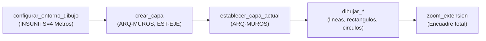
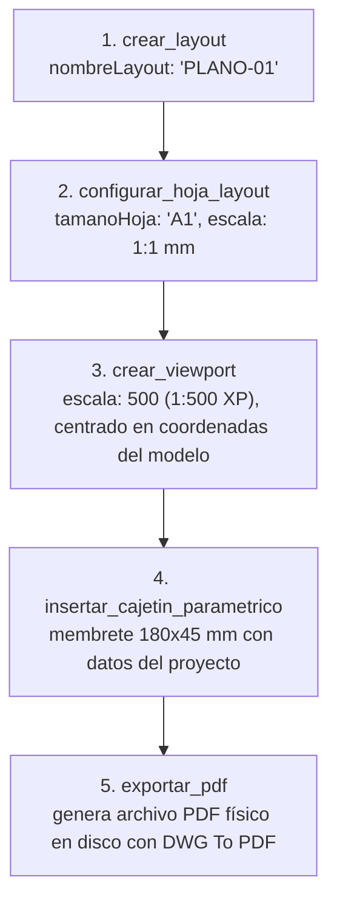
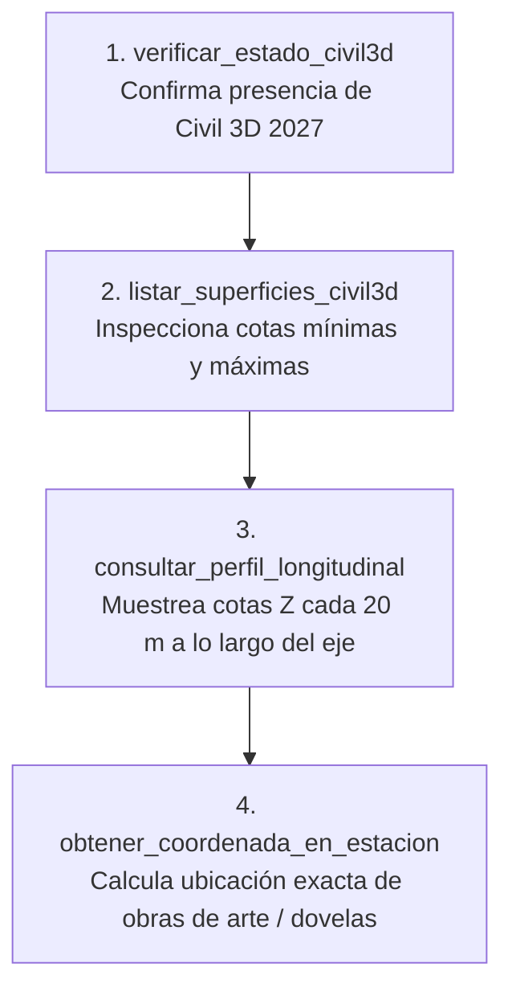
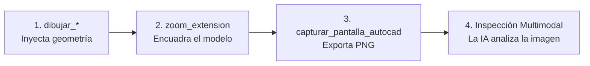

# Guía Rápida y Árbol de Decisión de Herramientas MCP (Cheat Sheet)

Este documento sirve como chuleta rápida (*cheat sheet*) y guía de decisión para usuarios, ingenieros y modelos de Inteligencia Artificial al interactuar con **`autocad-mcp`**.

Permite responder en segundos a la pregunta:  
**¿Qué herramienta MCP debo utilizar para lograr mi objetivo en AutoCAD o Civil 3D?**

---

## ⚡ Matriz de Decisión Rápida: "Qué quiero hacer" $\rightarrow$ "Qué tool usar"

| Intención / Objetivo en CAD | Herramienta Recomendada | Argumentos Clave | ¿Requiere CAD abierto? |
|---|---|---|:---:|
| **Verificar conectividad con el Gateway (puerto 5055)** | `ping_autocad_gateway` | *(ninguno)* | ✅ Sí |
| **Saber nombre de archivo, ruta y unidades configuradas** | `obtener_info_dibujo` | *(ninguno)* | ✅ Sí |
| **Consultar límites y caja delimitadora (ExtMin/ExtMax)** | `obtener_limites_dibujo` | *(ninguno)* | ✅ Sí |
| **Saber qué objetos tiene seleccionados el usuario** | `leer_seleccion_autocad` | *(ninguno)* | ✅ Sí |
| **Listar alineamientos horizontales de Civil 3D** | `listar_alineamientos_civil3d` | *(ninguno)* | ✅ Sí (Civil 3D) |
| **Medir distancia o pendiente entre 2 puntos** | `medir_distancia` | `x1, y1, x2, y2, z1, z2` | ❌ No (Local) |
| **Calcular área o perímetro de un ambiente/polígono** | `calcular_area_poligono` | `puntos: "x1,y1;x2,y2;..."` | ❌ No (Local) |
| **Configurar dibujo a metros (`INSUNITS=4`)** | `configurar_entorno_dibujo` | *(ninguno)* | ✅ Sí |
| **Trazar un muro, eje o línea recta** | `dibujar_linea` | `x1, y1, x2, y2, capa` | ✅ Sí |
| **Trazar un polígono o contorno perimetral** | `dibujar_polilinea` | `puntos, cerrada: true, capa` | ✅ Sí |
| **Trazar una habitación, pilar o zapata rectangular** | `dibujar_rectangulo` | `x1, y1, x2, y2, capa` | ✅ Sí |
| **Trazar un pozo, columna circular o túnel** | `dibujar_circulo` | `centroX, centroY, radio, capa` | ✅ Sí |
| **Trazar una bóveda o arco curvo** | `dibujar_arco` | `centroX, centroY, radio, a1, a2` | ✅ Sí |
| **Escribir un rótulo o texto técnico** | `insertar_texto` | `texto, x, y, altura, capa` | ✅ Sí |
| **Insertar un bloque ya definido (puerta, señal, etc.)** | `insertar_bloque` | `nombreBloque, x, y, escala` | ✅ Sí |
| **Crear una capa con color y tipo de línea** | `crear_capa` | `nombre, colorAci, tipoLinea` | ✅ Sí |
| **Cambiar la capa activa de trabajo** | `establecer_capa_actual` | `nombre` | ✅ Sí |
| **Apagar, congelar o bloquear una capa** | `establecer_estado_capa` | `nombre, accion: "congelar"` | ✅ Sí |
| **Saber qué capas existen en el plano** | `leer_capas_autocad` | *(ninguno)* | ✅ Sí |
| **Saber cuántos objetos hay en el plano** | `leer_objetos_autocad` | *(ninguno)* | ✅ Sí |
| **Saber qué bloques están cargados** | `listar_bloques_disponibles` | *(ninguno)* | ✅ Sí |
| **Buscar textos en el plano (ej. nombres de ambientes)** | `leer_textos_autocad` | *(ninguno)* | ✅ Sí |
| **Ver el plano ("ojos para la IA")** | `capturar_pantalla_autocad` | *(ninguno)* | ✅ Sí |
| **Encuadrar todo en pantalla** | `zoom_extension` | *(ninguno)* | ✅ Sí |
| **Guardar el archivo de dibujo** | `guardar_dibujo` | *(ninguno)* | ✅ Sí |
| **Limpiar definiciones huérfanas y reparar DWG** | `limpiar_y_purgar_dibujo` | `tipo: "todo", auditar: true` | ✅ Sí |
| **Forzar refresco gráfico** | `regenerar_todo` | *(ninguno)* | ✅ Sí |
| **Crear lámina para impresión (espacio papel)** | `crear_layout` | `nombreLayout` | ✅ Sí |
| **Configurar papel A0, A1, A2, A3 o A4 en PDF** | `configurar_hoja_layout` | `nombreLayout, tamanoHoja` | ✅ Sí |
| **Crear ventana gráfica centrada y a escala métrica** | `crear_viewport` | `x, y, w, h, escala, xMod, yMod` | ✅ Sí |
| **Dibujar cajetín / membrete técnico** | `insertar_cajetin_parametrico` | `xEsquina, yEsquina, titulo, plano`| ✅ Sí |
| **Generar archivo PDF final** | `exportar_pdf` | `nombreLayout, rutaPdf` | ✅ Sí |
| **Consultar la cota Z de un terreno en (X, Y)** | `consultar_elevacion_terreno` | `x, y, superficie` | ✅ Sí (Civil 3D) |
| **Muestrear perfil longitudinal de un eje vial/túnel** | `consultar_perfil_longitudinal`| `intervalo, alineamiento` | ✅ Sí (Civil 3D) |
| **Saber progresiva y desfase de un punto en un eje** | `consultar_estacion_alineamiento` | `x, y, alineamiento` | ✅ Sí (Civil 3D) |
| **Obtener coordenadas (X, Y) de un PK y desfase** | `obtener_coordenada_en_estacion` | `progresiva, desfase` | ✅ Sí (Civil 3D) |
| **Crear un eje vial con curvas circulares** | `crear_alineamiento_civil3d` | `nombre, puntos, radio` | ✅ Sí (Civil 3D) |
| **Crear una superficie TIN desde puntos** | `crear_superficie_civil3d` | `nombre, puntos` | ✅ Sí (Civil 3D) |
| **Ejecutar comandos especiales o plugins (ej. YQArch)** | `ejecutar_comando_autocad` | `command: "WW\n200\n"` | ✅ Sí |
| **Evaluar funciones AutoLISP en memoria** | `ejecutar_lisp` | `codigoLisp: "(+ 1 2)"` | ✅ Sí |
| **Cargar una rutina `.lsp` externa** | `cargar_archivo_lisp` | `rutaArchivoLsp` | ✅ Sí |

---

## 🔄 Flujos de Trabajo Estándar Encadenados (Workflows)

### Flujo 1: Configuración Inicial de Dibujo Limpio
Al comenzar un nuevo plano o diseño arquitectónico/estructural:

---

### Flujo 2: Producción de Lámina Técnica y Entrega en PDF
Para preparar un plano de entrega a partir del espacio modelo:

---

### Flujo 3: Ingeniería Civil y Trazado Vial / Túneles
Para análisis topográfico y diseño de infraestructuras lineales:

---

### Flujo 4: Bucle de Verificación Visual para la IA
Para que la IA valide autónomamente lo que dibuja:

---

## 💡 Consejos de Prompting para Asistentes de IA

1. **Prioriza herramientas tipadas sobre comandos de texto:**  
   En lugar de *"Escribe _.LINE 0,0 10,0 en la consola"*, pide:  
   *"Traza una línea de (0,0) a (10,0) en metros en la capa MUROS"*. La IA invocará `dibujar_linea`, evitando errores de salto de línea y cancelaciones accidentales de comando.

2. **Aprovecha el cálculo standalone para análisis previo:**  
   Si necesitas saber si un polígono tiene el área reglamentaria antes de dibujarlo, pide a la IA:  
   *"Calcula el área del polígono con vértices X,Y..."*. La IA usará `calcular_area_poligono` instantáneamente sin necesidad de esperar a AutoCAD.

3. **Indica siempre nombres de capa temáticos:**  
   Las herramientas `dibujar_*` crean la capa automáticamente si no existe. Especifica siempre capas normalizadas (ej. `ARQ-MUROS`, `EST-COLUMNAS`, `TUN-EJE`).

4. **Para Civil 3D, verifica primero la superficie:**  
   Pide a la IA *"Verifica las superficies disponibles en Civil 3D y consulta el perfil del alineamiento Eje-1"*. La IA encadenará `listar_superficies_civil3d` con `consultar_perfil_longitudinal` asegurando que no se generen errores de cota fuera de rango.
