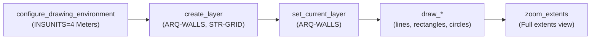
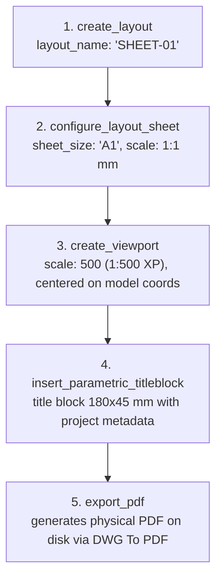
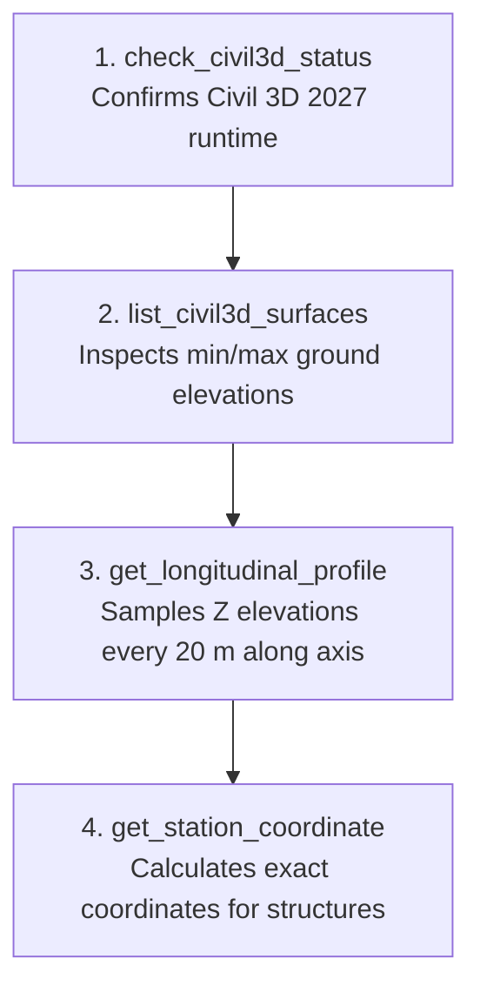
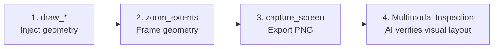

# Quick Reference & Decision Tree (MCP Tools Cheat Sheet)

This document serves as an actionable cheat sheet and decision guide for developers, engineers, and AI models interacting with **`autocad-mcp`**.

It answers in seconds:  
**Which MCP tool should I invoke to achieve my goal in AutoCAD or Civil 3D?**

---

## Quick Decision Matrix: "Goal" -> "Tool to Invoke"

| Design Goal / Intent in CAD | Recommended Tool | Key Arguments | Requires Running CAD? |
|---|---|---|:---:|
| **Check Gateway HTTP connectivity (port 5055)** | `ping_autocad_gateway` | *(none)* | Yes |
| **Get drawing name, DWG path, and units** | `get_drawing_info` | *(none)* | Yes |
| **Query bounding box extents (ExtMin/ExtMax)** | `get_drawing_extents` | *(none)* | Yes |
| **Inspect user's currently selected objects** | `read_selection` | *(none)* | Yes |
| **List Civil 3D horizontal alignments** | `list_civil3d_alignments` | *(none)* | Yes (Civil 3D) |
| **Measure distance, azimuth, or slope between points** | `measure_distance` | `x1, y1, x2, y2, z1, z2` | No (Local) |
| **Calculate polygon area or perimeter** | `calculate_polygon_area` | `points: "x1,y1;x2,y2;..."` | No (Local) |
| **Configure metric standard (`INSUNITS=4`)** | `configure_drawing_environment` | *(none)* | Yes |
| **Draw multiple entities / complete floor plan in 1 call** | `draw_batch_geometry` | `elements: [...]` | Yes |
| **Draw a wall, grid axis, or straight line** | `draw_line` | `x1, y1, x2, y2, layer` | Yes |
| **Draw a polyline boundary or perimeter** | `draw_polyline` | `points, closed: true, layer` | Yes |
| **Draw a room, column, or footing rectangle** | `draw_rectangle` | `x1, y1, x2, y2, layer` | Yes |
| **Draw a circular shaft, pillar, or tunnel arch** | `draw_circle` | `center_x, center_y, radius, layer` | Yes |
| **Draw a curved arch or vault** | `draw_arc` | `center_x, center_y, radius, start_angle, end_angle` | Yes |
| **Place single-line technical text or labels** | `insert_text` | `text, x, y, height, layer` | Yes |
| **Insert an existing block definition** | `insert_block` | `block_name, x, y, scale` | Yes |
| **Create a layer with color and linetype** | `create_layer` | `name, color_aci, linetype` | Yes |
| **Set the active working layer** | `set_current_layer` | `name` | Yes |
| **Toggle layer visibility, freeze, or lock** | `set_layer_state` | `name, action: "freeze"` | Yes |
| **List all layers and their visibility/lock states** | `read_layers` | *(none)* | Yes |
| **Count and summarize drawing objects by type** | `read_objects` | *(none)* | Yes |
| **List all loaded block definitions** | `list_available_blocks` | *(none)* | Yes |
| **Search text strings across model space** | `read_texts` | *(none)* | Yes |
| **Capture drawing image ("eyes for AI")** | `capture_screen` | *(none)* | Yes |
| **Zoom to drawing extents** | `zoom_extents` | *(none)* | Yes |
| **Save current drawing file** | `save_drawing` | *(none)* | Yes |
| **Purge unreferenced definitions and audit DWG** | `clean_and_purge_drawing` | `target: "all", audit: true` | Yes |
| **Force complete graphics regeneration** | `regen_all` | *(none)* | Yes |
| **Create paper space layout tab** | `create_layout` | `layout_name` | Yes |
| **Configure sheet size (A0–A4) and PDF plotter** | `configure_layout_sheet` | `layout_name, sheet_size` | Yes |
| **Create calibrated viewport with metric scale** | `create_viewport` | `x, y, width, height, scale, model_x, model_y` | Yes |
| **Draw parametric title block / sheet border** | `insert_parametric_titleblock` | `corner_x, corner_y, title, drawing_number`| Yes |
| **Export layout to physical PDF file** | `export_pdf` | `layout_name, pdf_path` | Yes |
| **Query ground surface elevation (Z) at (X, Y)** | `get_surface_elevation` | `surface_name, x, y` | Yes (Civil 3D) |
| **Sample longitudinal profile along an alignment** | `get_longitudinal_profile`| `alignment_name, surface_name, station_interval` | Yes (Civil 3D) |
| **Calculate station (chainage) and lateral offset** | `get_alignment_station_offset` | `alignment_name, x, y` | Yes (Civil 3D) |
| **Compute (X, Y) coordinates from station/offset** | `get_station_coordinate` | `alignment_name, station, offset` | Yes (Civil 3D) |
| **Create alignment from PIs with curves** | `create_civil3d_alignment` | `name, points, radius` | Yes (Civil 3D) |
| **Build topographic TIN surface from points** | `create_civil3d_surface` | `name, points` | Yes (Civil 3D) |
| **Execute a batch sequence of CAD commands** | `execute_batch_commands` | `commands: [...]` | Yes |
| **Execute raw CAD commands or plugin macros** | `execute_command` | `command: "WW\n200\n"` | Yes |
| **Evaluate dynamic in-memory AutoLISP expressions** | `execute_lisp` | `code: "(+ 1 2)"` | Yes |
| **Load external `.lsp` file from disk** | `load_lisp_file` | `file_path` | Yes |

---

## Standard Chained Workflows

### Workflow 1: Clean Drawing Initialization
When starting a new architectural or structural drawing:

---

## Workflow 2: Layout Sheet & PDF Delivery
Preparing a deliverable sheet directly from model space:

---

## Workflow 3: Civil Engineering Alignment & Profile
Topographic sampling and linear infrastructure analysis:

---

## Workflow 4: Visual Feedback Loop for AI Agents
Empowering AI agents to autonomously verify what they draw:

---

## Prompting Best Practices for AI Copilots

1. **Favor Typed Tools Over Raw Commands:**  
   Instead of *"Type _.LINE 0,0 10,0 in the console"*, ask:  
   *"Draw a line from (0,0) to (10,0) in meters on layer WALLS"*. The AI will call `draw_line`, avoiding line break syntax errors and accidental prompt cancellations.

2. **Leverage Standalone Analytical Tools:**  
   Before drawing, verify geometric constraints without invoking CAD:  
   *"Calculate the area of polygon X,Y..."*. The AI calls `calculate_polygon_area` instantaneously with zero latency.

3. **Specify Standard Layer Names:**  
   All `draw_*` tools automatically create layers if they do not exist. Always specify standard names (e.g. `ARQ-WALLS`, `STR-COLUMNS`, `TUN-AXIS`).

4. **Verify Surfaces Before Civil Profile Queries:**  
   Ask the AI: *"Check available Civil 3D surfaces and sample the profile for Alignment-1"*. The AI will chain `list_civil3d_surfaces` with `get_longitudinal_profile` to prevent out-of-boundary elevation queries.
