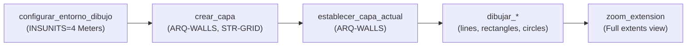
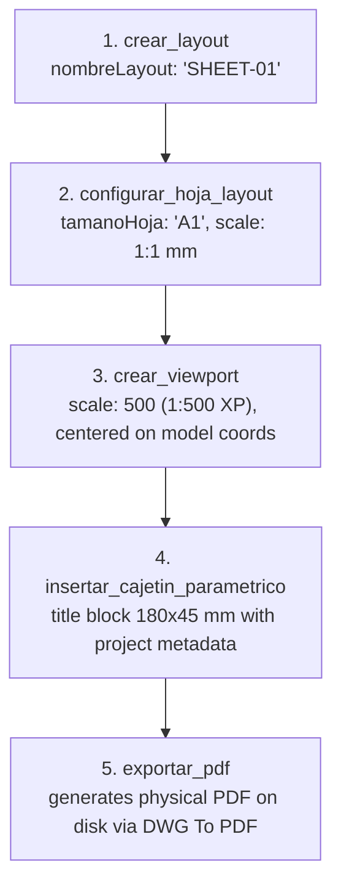
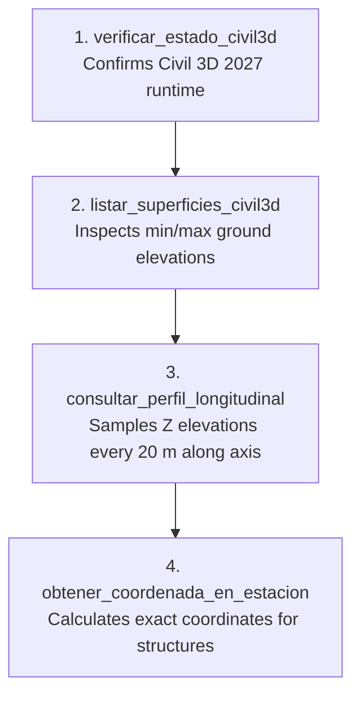
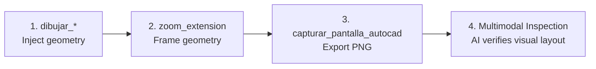

# Quick Reference & Decision Tree (MCP Tools Cheat Sheet)

This document serves as an actionable cheat sheet and decision guide for developers, engineers, and AI models interacting with **`autocad-mcp`**.

It answers in seconds:  
**Which MCP tool should I invoke to achieve my goal in AutoCAD or Civil 3D?**

---

## ⚡ Quick Decision Matrix: "Goal" $\rightarrow$ "Tool to Invoke"

| Design Goal / Intent in CAD | Recommended Tool | Key Arguments | Requires Running CAD? |
|---|---|---|:---:|
| **Check Gateway HTTP connectivity (port 5055)** | `ping_autocad_gateway` | *(none)* | ✅ Yes |
| **Get drawing name, DWG path, and units** | `obtener_info_dibujo` | *(none)* | ✅ Yes |
| **Query bounding box extents (ExtMin/ExtMax)** | `obtener_limites_dibujo` | *(none)* | ✅ Yes |
| **Inspect user's currently selected objects** | `leer_seleccion_autocad` | *(none)* | ✅ Yes |
| **List Civil 3D horizontal alignments** | `listar_alineamientos_civil3d` | *(none)* | ✅ Yes (Civil 3D) |
| **Measure distance, azimuth, or slope between points** | `medir_distancia` | `x1, y1, x2, y2, z1, z2` | ❌ No (Local) |
| **Calculate polygon area or perimeter** | `calcular_area_poligono` | `puntos: "x1,y1;x2,y2;..."` | ❌ No (Local) |
| **Configure metric standard (`INSUNITS=4`)** | `configurar_entorno_dibujo` | *(none)* | ✅ Yes |
| **Draw a wall, grid axis, or straight line** | `dibujar_linea` | `x1, y1, x2, y2, capa` | ✅ Yes |
| **Draw a polyline boundary or perimeter** | `dibujar_polilinea` | `puntos, cerrada: true, capa` | ✅ Yes |
| **Draw a room, column, or footing rectangle** | `dibujar_rectangulo` | `x1, y1, x2, y2, capa` | ✅ Yes |
| **Draw a circular shaft, pillar, or tunnel arch** | `dibujar_circulo` | `centroX, centroY, radio, capa` | ✅ Yes |
| **Draw a curved arch or vault** | `dibujar_arco` | `centroX, centroY, radio, a1, a2` | ✅ Yes |
| **Place single-line technical text or labels** | `insertar_texto` | `texto, x, y, altura, capa` | ✅ Yes |
| **Insert an existing block definition** | `insertar_bloque` | `nombreBloque, x, y, escala` | ✅ Yes |
| **Create a layer with color and linetype** | `crear_capa` | `nombre, colorAci, tipoLinea` | ✅ Yes |
| **Set the active working layer** | `establecer_capa_actual` | `nombre` | ✅ Yes |
| **Toggle layer visibility, freeze, or lock** | `establecer_estado_capa` | `nombre, accion: "congelar"` | ✅ Yes |
| **List all layers and their visibility/lock states** | `leer_capas_autocad` | *(none)* | ✅ Yes |
| **Count and summarize drawing objects by type** | `leer_objetos_autocad` | *(none)* | ✅ Yes |
| **List all loaded block definitions** | `listar_bloques_disponibles` | *(none)* | ✅ Yes |
| **Search text strings across model space** | `leer_textos_autocad` | *(none)* | ✅ Yes |
| **Capture drawing image ("eyes for AI")** | `capturar_pantalla_autocad` | *(none)* | ✅ Yes |
| **Zoom to drawing extents** | `zoom_extension` | *(none)* | ✅ Yes |
| **Save current drawing file** | `guardar_dibujo` | *(none)* | ✅ Yes |
| **Purge unreferenced definitions and audit DWG** | `limpiar_y_purgar_dibujo` | `tipo: "todo", auditar: true` | ✅ Yes |
| **Force complete graphics regeneration** | `regenerar_todo` | *(none)* | ✅ Yes |
| **Create paper space layout tab** | `crear_layout` | `nombreLayout` | ✅ Yes |
| **Configure sheet size (A0–A4) and PDF plotter** | `configurar_hoja_layout` | `nombreLayout, tamanoHoja` | ✅ Yes |
| **Create calibrated viewport with metric scale** | `crear_viewport` | `x, y, w, h, escala, xMod, yMod` | ✅ Yes |
| **Draw parametric title block / sheet border** | `insertar_cajetin_parametrico` | `xEsquina, yEsquina, titulo, plano`| ✅ Yes |
| **Export layout to physical PDF file** | `exportar_pdf` | `nombreLayout, rutaPdf` | ✅ Yes |
| **Query ground surface elevation (Z) at (X, Y)** | `consultar_elevacion_terreno` | `x, y, superficie` | ✅ Yes (Civil 3D) |
| **Sample longitudinal profile along an alignment** | `consultar_perfil_longitudinal`| `intervalo, alineamiento` | ✅ Yes (Civil 3D) |
| **Calculate station (chainage) and lateral offset** | `consultar_estacion_alineamiento` | `x, y, alineamiento` | ✅ Yes (Civil 3D) |
| **Compute (X, Y) coordinates from station/offset** | `obtener_coordenada_en_estacion` | `progresiva, desfase` | ✅ Yes (Civil 3D) |
| **Create alignment from PIs with curves** | `crear_alineamiento_civil3d` | `nombre, puntos, radio` | ✅ Yes (Civil 3D) |
| **Build topographic TIN surface from points** | `crear_superficie_civil3d` | `nombre, puntos` | ✅ Yes (Civil 3D) |
| **Execute raw CAD commands or plugin macros** | `ejecutar_comando_autocad` | `command: "WW\n200\n"` | ✅ Yes |
| **Evaluate dynamic in-memory AutoLISP expressions** | `ejecutar_lisp` | `codigoLisp: "(+ 1 2)"` | ✅ Yes |
| **Load external `.lsp` file from disk** | `cargar_archivo_lisp` | `rutaArchivoLsp` | ✅ Yes |

---

## 🔄 Standard Chained Workflows

### Workflow 1: Clean Drawing Initialization
When starting a new architectural or structural drawing:

---

## Workflow 2: Layout Sheet & PDF Delivery
Preparing a deliverable sheet directly from model space:

---

## Workflow 3: Civil Engineering Alignment & Profile
Topographic sampling and linear infrastructure analysis:

---

## Workflow 4: Visual Feedback Loop for AI Agents
Empowering AI agents to autonomously verify what they draw:

---

## 💡 Prompting Best Practices for AI Copilots

1. **Favor Typed Tools Over Raw Commands:**  
   Instead of *"Type _.LINE 0,0 10,0 in the console"*, ask:  
   *"Draw a line from (0,0) to (10,0) in meters on layer WALLS"*. The AI will call `dibujar_linea`, avoiding line break syntax errors and accidental prompt cancellations.

2. **Leverage Standalone Analytical Tools:**  
   Before drawing, verify geometric constraints without invoking CAD:  
   *"Calculate the area of polygon X,Y..."*. The AI calls `calcular_area_poligono` instantaneously with zero latency.

3. **Specify Standard Layer Names:**  
   All `dibujar_*` tools automatically create layers if they do not exist. Always specify standard names (e.g. `ARQ-WALLS`, `STR-COLUMNS`, `TUN-AXIS`).

4. **Verify Surfaces Before Civil Profile Queries:**  
   Ask the AI: *"Check available Civil 3D surfaces and sample the profile for Alignment-1"*. The AI will chain `listar_superficies_civil3d` with `consultar_perfil_longitudinal` to prevent out-of-boundary elevation queries.
